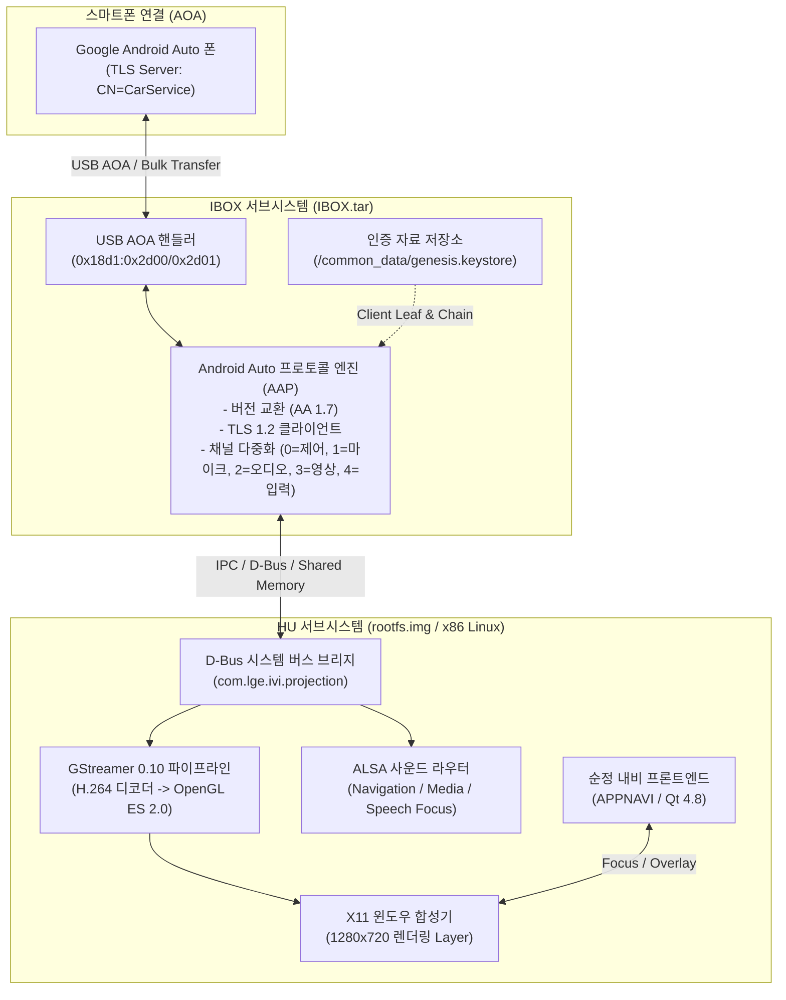

# 04_ANDROID_AUTO_MODULE_MAP.md: Android Auto 관련 모듈 식별 및 의존성 맵

## 1. 펌웨어 내 Android Auto 관련 모듈 분류

제네시스 고급형 2세대 (DHPE / G80 DIS) 순정 펌웨어 전수 조사를 바탕으로 모듈의 연관성을 3단계로 분류하였다.

| 모듈 / 아카이브 | 역할 및 설명 | 파일 크기 | 연관도 | 바이너리 / 컨테이너 형식 |
|---|---|---|---|---|
| **`IBOX.tar`** | **인터페이스/통신 박스(IBOX) 서브시스템** - 스마트폰 USB AOA 연결 감지 및 프로토콜 게이트웨이 - 폰 프로젝션(Android Auto / CarPlay) 프로토콜 스택 - 텔레매틱스 및 모뎀 통신 인터페이스 | 402,335,780 B (~402 MB) | **높음 (HIGH)** | LGE "TER" 암호화 컨테이너 (`TER\xa7` 푸터) |
| **`HU/images/NP/rootfs.img`** | **헤드유닛 메인 루트 파일시스템 (2.56 GB)** - MeeGo Linux 기반 IVI 시스템 전장 서비스 - 프로젝션 X11 디스플레이 윈도우 합성 및 터치 이벤트 핸들러 - GStreamer 기반 H.264 영상 디코더 및 ALSA 오디오 라우팅 - D-Bus 시스템 버스 프로젝션 브리지 | 2,567,399,572 B (~2.56 GB) | **높음 (HIGH)** | LGE "TER" 암호화 컨테이너 (`TER...` 푸터) |
| **`genesis.keystore`** | **보안 키스토어 컨테이너** - `AppUpgrade` 바이너리 내 Qt 리소스(`:decrypt/genesis.keystore`)로 포함 - `/common_data/upgrade/decrypt/genesis.keystore` 경로에 프로비저닝 - 기기/제조사 인증서 및 신뢰 앵커(Trust Anchor) 관리 | 가변 (qrc 내장) | **높음 (HIGH)** | Java/OpenSSL Keystore 컨테이너 |
| **`AppUpgrade`** | **업그레이드 및 펌웨어 복호화 관리자** - `IBOX.tar` 및 `rootfs.img`의 복호화 파이프라인 관리 - `DecryptToFile` / `DecryptToPIPE` 제어 - 무결성 해시(SHA-256) 및 서명 검증 | 1,274,224 B (~1.27 MB) | **중간 (MEDIUM)** | ELF 32-bit x86 Linux (stripped) |
| **`essentials/decrypt/DecryptToFile`** | **LGE 암호화 패키지 복호화 엔진** - RSA 공개키 연산(`MBEDTLS_RSA_PUBLIC`)을 통한 128비트 AES 세션키 복구 - AES-128 CBC/ECB 스트림 복호화 - DWARF 디버그 심볼 포함으로 구조 규명 완료 | 187,986 B (~187 KB) | **중간 (MEDIUM)** | ELF 32-bit x86 Linux (with debug info) |
| **`G:\BIN\APPNAVI`** | **순정 내비게이션 프론트엔드 UI** - 1280x720 해상도 지도 및 경로 렌더링 - D-Bus를 통해 프로젝션 화면 활성화 시 오디오/HUD 연동 | 5,993,104 B (~5.99 MB) | **중간 (MEDIUM)** | ELF 32-bit x86 Linux (stripped) |
| **`libgstreamer-0.10.so.0`** | **멀티미디어 스트리밍 파이프라인** - H.264 영상 스트림 디코딩 및 프레임 버퍼 싱크 | rootfs 내장 | **중간 (MEDIUM)** | ELF 32-bit x86 공유 라이브러리 |
| **`libasound.so.2`** | **ALSA 오디오 시스템** - 미디어/내비 안내/음성인식 멀티 채널 믹싱 | rootfs 내장 | **중간 (MEDIUM)** | ELF 32-bit x86 공유 라이브러리 |
| **`HU/images/boot.img`** | **리눅스 커널 및 부트로더** | 45,565,256 B (~45.5 MB) | **낮음 (LOW)** | LGE "TER" 암호화 커널 이미지 |
| **`HU/images/vr.img`** | **음성인식(VR) 음향 모델 및 사전** | 1,785,153,017 B (~1.78 GB) | **낮음 (LOW)** | Partclone EXTFS v0001 (Nuance) |
| **`G:\DATA\*`** | **정적 지도 POI, 폰트, 효과음 리소스** | 수 GB | **낮음 (LOW)** | 전용 리소스 파일 (.ares, .hafmma) |

---

## 2. 모듈 간 연동 및 아키텍처 다이어그램

---

## 3. 핵심 모듈의 기술적 특성 분석

1. **분산 서브시스템 구조 (HU - IBOX 분리)**:
   - 제네시스 DH/G80 고급형 2세대는 단일 프로세서 시스템이 아닌 **메인 디스플레이/내비게이션 유닛(HU)**과 **통신/프로젝션 인터페이스 유닛(IBOX)**이 물리적 또는 가상화로 분리된 분산 아키텍처를 채택하고 있다.
   - IBOX는 텔레매틱스(Bluelink), 모뎀, USB AOA 인터페이스를 관할하며 스마트폰과의 직접적인 물리 통신 및 암호화 세션(AAP 프로토콜 수신기)을 전담한다.
2. **미디어 스트리밍 파이프라인**:
   - IBOX에서 수신된 암호화 해제된 H.264 비디오 패킷과 오디오 PCM 스트림은 IPC를 통해 메인 HU로 전달되며, HU에서는 표준 리눅스 멀티미디어 프레임워크인 **GStreamer 0.10**과 **ALSA**를 통해 화면과 스피커로 출력된다.
3. **인증 자료(Keystore) 관리**:
   - 프로젝션 인증에 필수적인 인증서 및 키체인은 `genesis.keystore` 형태로 펌웨어 업데이트 단계에서 `/common_data/upgrade/decrypt/genesis.keystore`로 전개된다.
